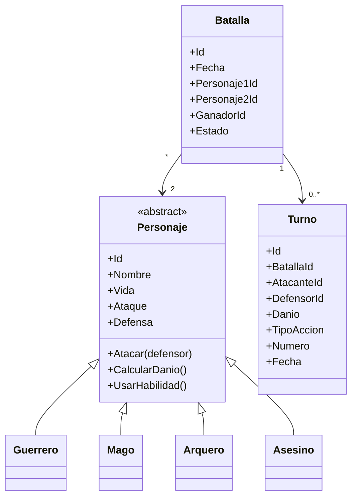
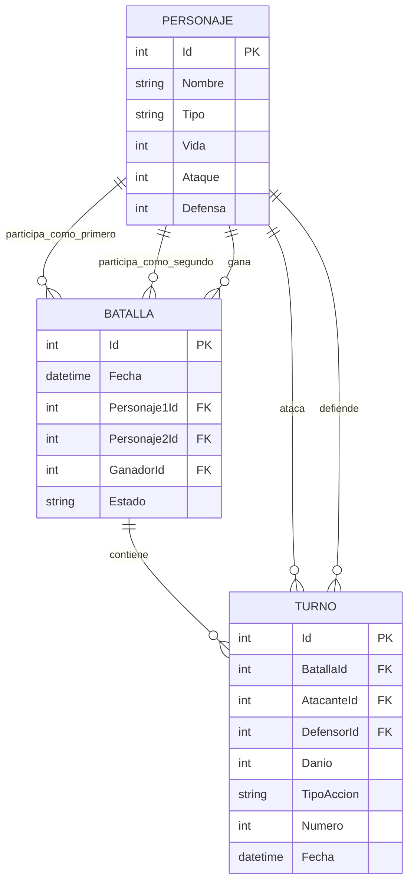

# Punto de partida — Combate por API

## Modelo inicial

El modelo existente antes de incorporar la API ya separaba los personajes (`Personaje`, `Guerrero`, `Mago`, `Arquero` y `Asesino`), los servicios de aplicación y los repositorios. La propuesta inicial consiste en conservar esa separación y agregar una capa HTTP que no exponga directamente las entidades.

### Diagrama de clases (propuesta inicial)

### DER inicial

## Recorrido de solicitudes previsto

1. El cliente crea dos personajes enviando `{ "nombre": "Conan", "tipo": "Guerrero" }` y `{ "nombre": "Merlin", "tipo": "Mago" }`.
2. El cliente inicia un combate enviando los dos IDs; el servidor verifica que sean distintos, existan y estén vivos.
3. El cliente consulta el combate y obtiene participantes, estado, turnos y ganador si ya finalizó.
4. El cliente envía un turno con `atacanteId` y `accion` (`atacar` o `habilidad`). El servidor determina al defensor y valida la alternancia.
5. Cada turno guarda la vida previa de ambos participantes para permitir deshacer únicamente el último turno.

## Respuestas y errores previstos

- `200`: consulta o modificación exitosa.
- `201`: personaje o combate creado.
- `204`: eliminación exitosa sin cuerpo.
- `400`: JSON, nombre, tipo, participantes, acción o turno inválido.
- `404`: el personaje, combate o turno solicitado no existe.
- `409`: se intenta eliminar/modificar un recurso protegido por su historial, o borrar un turno que no es el último.

## Hipótesis y dudas iniciales

- El tipo concreto debe decidir el daño y la habilidad mediante métodos virtuales/abstractos, no mediante condicionales en la ejecución del ataque.
- El orden de los turnos puede determinarse a partir del número de turno: primero el participante 1 y después el participante 2.
- El estado del combate necesita persistirse junto con la vida actual de los participantes.
- Para deshacer un turno no alcanza con borrar el historial: también hay que guardar la vida previa de los dos personajes y el estado/ganador anterior.
- Las lecturas y escrituras deben usar credenciales distintas; queda por comprobar que el usuario invitado no pueda escribir.
